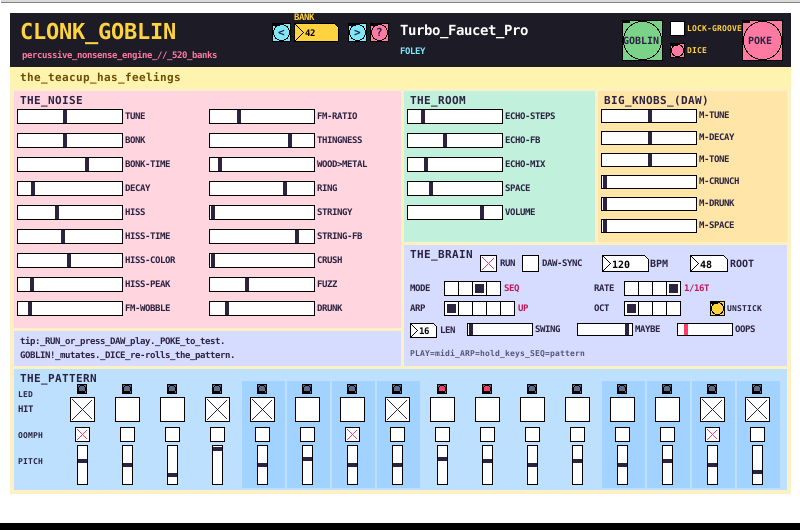

# 🧌 CLONK GOBLIN

**A Pure Data percussion / IDM / foley instrument plugin that builds as a VST3 (and AU) for macOS, including Apple Silicon (M1 to M4 Pro).**

Rubbery bonks, chrome ticks, wet drips, junkyard clanks, crunchy zaps and tiny haunted teacups.
It ships with **520 sound banks**, each paired with its own groove, plus a **16-step sequencer**, an **arpeggiator**, and a goblin that steals knobs.



🎧 **Hear it first:** [`docs/demo.mp3`](docs/demo.mp3), a 72-second tour through 18 banks rendered straight from the patch.

---

## What's inside

| Thing | What it does |
|---|---|
| **Voice engine** (8-voice, round-robin) | Pitch-"bonk" sine → FM wobble → filtered hiss → 3-mode **resonator** (wood → metal) → Karplus **string** → fuzz → bit/sample **crush** → random "drunk" pan & detune |
| **520 banks** | 13 silly categories × 40: `BONK` `SNAP` `TSST` `FOLEY` `METAL` `ZAP` `PLUCK` `GLITCH` `BLIP` `GOOP` `BONGO` `CLANK` `DRIP`. Every bank is level-matched (each one was rendered and its trim calibrated). |
| **520 grooves** | Each bank brings a pattern that suits it: euclidean kicks, ratcheting hats, odd-length foley loops (5/7/11/13 steps), scale-aware melodic bleeps |
| **Sequencer** | 16 steps with HIT / OOMPH (accent) / PITCH per step, LEN 1–16 (polymeter!), RATE 1/8 · 1/16 · 1/32 · 1/16T, SWING, MAYBE (probability), **OOPS** (random IDM ratchets) |
| **Arpeggiator** | UP · DOWN · UP+DOWN · RANDOM · DRUNK, 1–4 octaves |
| **Modes** | `PLAY` (MIDI plays it like a drum synth) · `ARP` (hold keys) · `SEQ` (pattern plays; last held key transposes) · `SEQ+ARP` (pattern gates the arp) |
| **FX** | Tempo-synced ping-pong dub echo + a small "junkyard" reverb |
| **Silly buttons** | **GOBLIN!** steals ~35 % of the knobs (and some groove) from a random bank · **DICE** re-rolls the pattern · **?** jumps to a random bank · **POKE** auditions · **LOCK-GROOVE** keeps your pattern while you browse sounds · **UNSTICK** clears stuck notes |

---

## Install on a Mac (M4 Pro)

### Route A: real `ClonkGoblin.vst3` with Camomile (recommended)

1. Download **Camomile v1.0.8-beta10 or newer** for macOS from
   https://github.com/pierreguillot/Camomile/releases.
   Use that version, because it is the one that adds native Apple Silicon support. Unzip it.
2. In Terminal:
   ```bash
   cd path/to/ClonkGoblin
   ```
   ```bash
   ./build_mac.sh ~/Downloads/Camomile
   ```
   (use the path of the unzipped Camomile folder, the one with the `camomile` script inside)
3. The script builds `ClonkGoblin.vst3` and `ClonkGoblin.component` and copies them to
   `~/Library/Audio/Plug-Ins/`. It also removes the quarantine flag, re-signs them ad-hoc (required on
   Apple Silicon) and tells you which CPU architectures the binary contains.
4. Rescan plugins in your DAW (Ableton, Bitwig, Reaper, Logic for the AU…) and add **ClonkGoblin** as an instrument.

**Manual Camomile build** (if the script can't find Camomile's generator):
copy Camomile's *instrument* `Camomile.vst3` bundle and rename it to `ClonkGoblin.vst3`. Right-click it → *Show Package Contents* and copy **everything inside** the `ClonkGoblin/` folder into `Contents/Resources/`. Set `CFBundleName` / `CFBundleDisplayName` in `Contents/Info.plist` to `ClonkGoblin`, then run:
```bash
xattr -dr com.apple.quarantine ~/Library/Audio/Plug-Ins/VST3/ClonkGoblin.vst3
```
```bash
codesign --force --deep --sign - ~/Library/Audio/Plug-Ins/VST3/ClonkGoblin.vst3
```

### Route B: zero-build, inside plugdata

[plugdata](https://plugdata.org) is a free, native Apple Silicon VST3/AU that runs Pd patches.
Load the **plugdata** instrument in your DAW, then *File → Open* `ClonkGoblin/ClonkGoblin.pd`.
Turn on *Presentation/Plugin mode* to see just the face. Limitations: DAW automation of the
"BIG KNOBS" and DAW transport sync are Camomile features, so in plugdata press **RUN** to start the
sequencer.

### Route C: plain Pure Data

Open `ClonkGoblin/ClonkGoblin.pd` in Pd 0.52+, turn DSP on, press **RUN** or **POKE**.

---

## 30-second tutorial

1. Press play in the DAW. **DAW-SYNC** is on by default, so the bank's own groove starts in time with your project (or press **RUN** for the internal clock).
2. Click **<** / **>** / **?** to browse banks. The name, category and a helpful(?) message appear at the top.
3. Like the sound but not the beat? Turn on **LOCK-GROOVE**, keep browsing, or hit **DICE**.
4. Hit **GOBLIN!** a few times. It mutates the current sound by stealing bones from other banks.
5. Turn up **OOPS** for glitchy ratchet rolls, lower **MAYBE** to let steps randomly skip, and set **LEN** to 7 or 11 for wonky polymeters.
6. Play MIDI keys: in `SEQ` they transpose the pattern, in `ARP` / `SEQ+ARP` they become the arpeggio.

### The knobs, translated

| Label | Real meaning |
|---|---|
| TUNE | pitch offset (semitones) |
| BONK / BONK-TIME | pitch-drop depth (negative = rising "bloop") / how fast it drops |
| DECAY | amp decay of the body |
| HISS / HISS-TIME / HISS-COLOR / HISS-PEAK | noise amount / decay / band-pass frequency / resonance |
| FM-WOBBLE / FM-RATIO | FM index / modulator ratio (odd ratios = clang) |
| THINGNESS / WOOD>METAL / RING | resonator mix / mode ratios from membrane-wood to metal bar / ring time |
| STRINGY / STRING-FB | Karplus-Strong string mix / sustain |
| CRUSH / FUZZ / DRUNK | bit+rate reduction / tanh drive / random pan + detune per hit |
| ECHO-STEPS (in steps) / ECHO-FB / ECHO-MIX / SPACE / VOLUME | the room |

### DAW parameters (automatable in Camomile builds)

`Bank`, `Tune`, `Decay`, `Tone`, `Crunch`, `Drunk`, `Space`, `Mode`, `Volume`.
The macros are **offsets on top of** whatever the bank does, so automating them never ruins a preset.
VST3 has no factory-program list in Camomile, so banks are chosen with the **Bank** parameter, which is
automatable too. Your whole state, including tweaks and pattern, is saved with the DAW project via
Camomile's save/load messages.

---

## Project layout

```
ClonkGoblin/           <- the plugin folder (Camomile needs this exact name)
  ClonkGoblin.pd       main patch + face (graph-on-parent)
  ClonkGoblin.txt      Camomile description (instrument, MIDI in, playhead, 9 params)
  cg-voice.pd          one voice (cloned 8x)
  cg-brain.pd          sequencer + arpeggiator + modes + OOPS ratchets
  cg-clock.pd          internal clock / DAW playhead sync + swing
  cg-fx.pd             echo + reverb
  cg-bank.pd           bank/groove loading, GOBLIN, DICE, quips
  cg-host.pd           Camomile params + state save/load
  cg-params.pd         parameter store
  banks.txt grooves.txt quips.txt
tools/                 Python generators (the patches are generated, edit these!)
  generate.py          writes every .pd file and the Camomile .txt
  presets.py           the 13 sound recipes + groove designer + silly name generator
  calibrate.py         renders every bank and computes its level trim (levels.json)
  render.py demo.py    offline render / test helpers (need Pd + numpy)
build_mac.sh           Camomile build + install + sign helper
```

To make **more or different banks**, edit `tools/presets.py` (recipes, names, counts) and run
`python3 tools/generate.py`. Then re-run `tools/calibrate.py` and `generate.py` once more to level-match them.

## Notes and honest limitations

- It is all **vanilla Pd** (no externals), so it runs anywhere Camomile, plugdata or Pd runs. CPU use
  is tiny: in an offline test it rendered about 20× faster than real time on one core of a cloud
  container.
- Tested here: every patch loads without errors in Pd 0.54, all 520 banks render (no silence,
  no NaNs), and the arp, modes, GOBLIN, LOCK, DICE and Camomile param/save/load messages were all
  exercised in an offline harness. **Not tested here:** an actual DAW on macOS. Camomile's state
  restore and playhead formats follow its documentation; if anything misbehaves, run the plugin
  in Camomile's console and the Pd errors will show there.
- The string model runs at a 16-sample block, so very high-pitched STRINGY notes (above ~2.7 kHz) flatten out.
- The sounds are synthesized from scratch with general left-field electronic percussion
  techniques. No samples, no references, and nobody else's presets.
